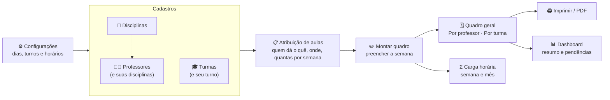

# Guia das telas — como o SEICE funciona por dentro

Este guia explica **o que cada tela faz** e **como as telas conversam entre si**: o que você cadastra em uma aparece (ou muda) nas outras. Leia uma vez do começo ao fim e o sistema inteiro passa a fazer sentido.

> Toda tela tem o botão **Como usar** (canto superior direito), com os passos daquela tela em linguagem simples.

---

## 1. O caminho em uma frase

**Configure os horários → cadastre disciplinas, professores e turmas → diga quem dá aula onde (atribuição) → monte o quadro → confira, imprima e acompanhe a carga horária.**

Cada seta quer dizer: **a tela da direita usa o que foi feito na tela da esquerda.**

---

## 2. As peças (o que o sistema guarda)

| Peça | O que é | Onde se mexe | Quem usa |
| --- | --- | --- | --- |
| **Horários dos turnos** | Os períodos de cada turno (1º horário 07:00–07:50, intervalo…) e os dias letivos | Configurações | Todas as grades, Montar quadro, Carga horária |
| **Disciplina** | Nome e cor (a cor pinta as aulas em todas as grades) | Disciplinas | Professores, Atribuição, todas as grades |
| **Professor** | Dados, foto e **as disciplinas que leciona** | Professores | Atribuição, Montar quadro (sugere as disciplinas dele primeiro) |
| **Turma** | Nome, ano/série e **turno** (manhã, tarde, noite ou integral) | Turmas | O turno define quais horários a turma tem na grade |
| **Atribuição** | "Ana dá **Matemática** no **6º A**, **5 aulas por semana**" | Atribuição de aulas | Montar quadro (preenche o professor sozinho e mostra o que falta) |
| **Aula** | Uma aula marcada: turma + professor + disciplina + dia + horário | Montar quadro, Quadro geral, Por professor, Por turma | Todas as grades, Carga horária, Dashboard, Impressão |

**Regra de ouro:** a **atribuição** é o *combinado* (quantas aulas cada um deve dar); a **aula** é o que está *de fato na grade*. As telas comparam as duas e mostram o que falta.

---

## 3. Tela por tela

### ⚙️ Configurações
- **Faz:** define os dias letivos, os turnos que a escola usa e os horários de cada turno (aulas e intervalos).
- **Comunica com:** todas as grades. Se você muda o horário do 1º horário aqui, todas as grades passam a mostrar o novo horário.
- **Seguro:** mudar horários **nunca apaga aulas**. Se alguma aula ficar fora da nova grade, o sistema avisa antes de salvar.

### 📘 Disciplinas
- **Faz:** cadastra as disciplinas e a **cor** de cada uma.
- **Comunica com:** a cor aparece em todas as grades, na Atribuição e na Carga horária. A tela também mostra quantas aulas cada disciplina tem e em quais turmas.

### 👩‍🏫 Professores
- **Faz:** cadastra professores, foto e **as disciplinas que cada um leciona** (pode ser mais de uma).
- **Comunica com:**
  - **Atribuição** e **Montar quadro** mostram primeiro as disciplinas do professor.
  - Quando você grava uma aula ou uma atribuição com uma disciplina nova para o professor, ela passa a constar nas disciplinas dele automaticamente.
  - Inativar um professor tira ele das listas de escolha, sem apagar o histórico.

### 🎓 Turmas
- **Faz:** cadastra turmas com o **turno**.
- **Comunica com:** o turno decide quais horários aparecem para a turma no Montar quadro e no Quadro geral (uma turma da manhã só aparece nos horários da manhã; a integral, nos dois).

### 📋 Atribuição de aulas
- **Faz:** registra **quem dá cada disciplina em cada turma** e **quantas aulas por semana**. Cada turma tem **um professor por disciplina**.
- **Duas formas de ver:**
  - **Por professor** — escolha o professor e clique em **Atribuir turmas**: marque a disciplina e **várias turmas de uma vez**, cada uma com suas aulas por semana.
  - **Por turma** — cada disciplina da turma em uma linha: professor, aulas por semana e situação no quadro.
- **Salva sozinho** (não tem botão salvar).
- **Comunica com:**
  - **Montar quadro**: ao escolher a disciplina, o professor atribuído **já vem preenchido**; a faixa "Atribuição desta turma" mostra **"2 de 3"** (2 aulas já na grade, de 3 combinadas) e fica **verde** quando bate.
  - A coluna **No quadro** desta tela conta as aulas já lançadas: *nenhuma no quadro*, *faltam 2*, *completo* ou *1 a mais*.

### ✏️ Montar quadro
- **Faz:** preencher a semana inteira direto na grade, sem formulário.
- **Por turma:** em cada horário, escolha **Disciplina** e **Professor**.
- **Por professor:** cada horário vago mostra **todas as turmas daquele turno**:
  - **verde** = turma livre → **um clique** coloca a aula ali;
  - **cinza com cadeado** = turma ocupada com outro professor (mostra quem).
- **Nada é gravado a cada clique.** Os horários alterados ficam com **borda amarela** e a barra do rodapé mostra *"3 alterações não salvas · Descartar · Salvar quadro"*. Se tentar sair sem salvar, o sistema pergunta.
- Duas células seguidas com a mesma aula viram uma **aula dupla**.
- **Comunica com:** ao salvar, as aulas aparecem no Quadro geral, Por professor, Por turma, Carga horária, Dashboard e Impressão.

### 🗓️ Quadro geral
- **Faz:** mostra a escola inteira. Escolha um dia (Segunda… Sexta) ou **Semana inteira**, e o turno.
- **Filtros** por professor, turma e disciplina valem nas duas visões (ex.: escolha a professora Ana em *Semana inteira* para ver a semana dela em todas as turmas).
- Clique numa aula para **ver, editar, duplicar ou excluir**; clique num horário vago para **lançar** uma aula.
- Se o horário estiver ocupado, o sistema pergunta se você quer **substituir**, **trocar** os horários ou **passar** a aula para outro professor.

### 👤 Por professor · 🎓 Por turma
- **Faz:** a semana de **um** professor ou de **uma** turma, pronta para conferir e **imprimir/salvar em PDF**.
- **Atalho:** o botão **Montar quadro** abre a mesma pessoa/turma no editor de grade.

### Σ Carga horária
- **Faz:** tabela professor × turma com quantas aulas cada um dá **por semana** e o **total por semana e por mês** (mês de 4, 4,5 ou 5 semanas, à sua escolha). Aula dupla conta como duas.
- **Comunica com:** lê as aulas do quadro. Exporta para **Excel**.

### 📊 Dashboard
- **Faz:** o resumo da escola: números, horários vagos, conflitos, o que está acontecendo agora e os **primeiros passos** para quem está começando.

### 🖨️ Impressão
- Por professor, por turma, de todas as turmas ou de todos os professores, em A4 paisagem. Escolha *Salvar como PDF* para gerar o arquivo.

---

## 4. Regras que valem em todas as telas

- **Ninguém fica em dois lugares ao mesmo tempo.** O sistema impede professor em duas turmas no mesmo horário e turma com duas aulas ao mesmo tempo — na tela, no servidor e no próprio banco de dados.
- **Cores:** a cor de uma aula é sempre a cor da disciplina. **Borda vermelha** = conflito. **Borda amarela** = alterado e ainda não salvo.
- **Planilhas:** quase todas as telas têm **Importar** (Excel ou CSV), com modelo pronto para baixar. Reimportar a mesma planilha não duplica nada.
- **Tudo atualiza junto:** o que você grava aparece nas outras telas na hora. Em outro computador, aparece quando a pessoa volta para a aba do sistema ou atualiza a página.

---

## 5. Exemplo completo: colocar a Ana em Matemática no 6º A e no 7º A

1. **Disciplinas** → confira que *Matemática* existe.
2. **Professores** → abra a Ana e marque *Matemática* nas disciplinas dela.
3. **Atribuição de aulas → Por professor** → Ana → **Atribuir turmas** → *Matemática* → marque **6º A** e **7º A** → 5 aulas por semana → **Salvar atribuição**.
4. **Montar quadro → Por turma** → 6º A → num horário vago escolha *Matemática*: a **Ana já aparece preenchida**. Repita até a etiqueta *Matemática · Ana* ficar **verde (5 de 5)**. Clique em **Salvar quadro**.
5. **Quadro geral → Semana inteira**, filtro *Professor: Ana* → confira a semana dela.
6. **Por professor → Ana → Imprimir ou PDF** → entregue o horário a ela.
7. **Carga horária** → veja o total da Ana por semana e por mês.
